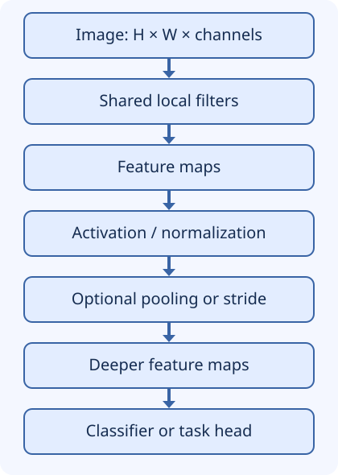

## What you will be able to explain

Calculate the output of a small filter, predict a convolution's tensor shape and
parameter count, distinguish translation equivariance from invariance, and choose
downsampling deliberately. You need basic arrays, weighted sums, neural-network
training, and backpropagation. This is an architecture lesson, not a full training
course. The examples run with Python 3 and NumPy; no GPU, model download, or paid
service is required. Run each Python block independently in a local environment.

## Why a dense network is an expensive starting point

A 224 × 224 RGB image contains `224 * 224 * 3 = 150,528` values. Connecting every
value to 1,000 neurons requires **150,528,000 weights**, plus 1,000 biases. Worse,
that dense layer has no architectural reason to reuse an edge detector at both the
top-left and bottom-right of an image.

A convolutional neural network (CNN) imposes an **inductive bias**: nearby values
interact locally, and the same filter is useful at multiple locations. An inductive
bias is a structural assumption that favors some solutions over others. It can make
learning more data-efficient when the assumption matches the task; it is not proof
that the model will generalize.

CNNs also operate on audio, time series, and other grid-like signals. The relevant
property is local, reusable structure, not the word “image.” Flattening an image
does not mathematically erase its pixels or prevent a dense network from learning
spatial relationships; it removes the explicit spatial organization and locality
bias from that dense layer's connectivity.

## A shared filter becomes a feature map



Text alternative: image → shared local filters → feature maps → activation and
normalization → optional downsampling → deeper features → task-specific head.
Activation and normalization order varies across architectures; pooling is optional.

For an input described as `(height, width, input_channels)`, each ordinary dense
convolution filter spans all input channels. Each output channel has its own filter
and usually its own bias. The filter is **shared across positions**, not shared
between different output channels. Grouped and depthwise convolutions deliberately
change the channel connections.

Most deep-learning libraries call the following operation “convolution,” although
it is technically **cross-correlation**: the kernel is not reversed. For one input
channel, stride 1, and no padding:

```text
Y[i,j] = sum over u=0..k_h-1, v=0..k_w-1 of
         K[u,v] * X[i+u,j+v] + b
```

Multiply corresponding patch and kernel values, sum the products, and add the bias
once per output location. With multiple input channels, also sum across channels.
Learned filters need not look like human-designed edge detectors.

## Trace a convolution by hand

Use this input, kernel, and zero bias:

```text
input X             kernel K
1  1  4             -1  1
2  2  5             -1  1
3  3  6
```

The top-left output is `-1*1 + 1*1 - 1*2 + 1*2 = 0`.
The top-right is `-1*1 + 1*4 - 1*2 + 1*5 = 6`.
The bottom-left is `-1*2 + 1*2 - 1*3 + 1*3 = 0`.
The bottom-right is `-1*2 + 1*5 - 1*3 + 1*6 = 6`.

```text
output Y
0  6
0  6
```

The response detects an increase toward the right. It is not yet an object detector.
Subsequent learned layers combine responses, with nonlinearities enabling more than
a single linear transformation of the original input.

## Run the calculation with NumPy

This is the authored module's one-channel, one-filter example, with an output
assertion added. It demonstrates a forward pass, not training or an optimized
implementation.

```python
import numpy as np

image = np.array([[1., 1., 4.], [2., 2., 5.], [3., 3., 6.]])
kernel = np.array([[-1., 1.], [-1., 1.]])
kh, kw = kernel.shape
out_h = image.shape[0] - kh + 1
out_w = image.shape[1] - kw + 1
output = np.empty((out_h, out_w))
for i in range(out_h):
    for j in range(out_w):
        patch = image[i:i + kh, j:j + kw]
        output[i, j] = np.sum(patch * kernel)
np.testing.assert_allclose(output, [[0., 6.], [0., 6.]])
print(output)
```

Expected output: `[[0. 6.], [0. 6.]]`, displayed on two rows by NumPy. Production
libraries use optimized kernels rather than this teaching loop.

## Predict shapes and parameter counts

For symmetric padding `p`, stride `s`, dilation `d`, and kernel size `k` along one
axis, define:

```text
effective_kernel = d * (k - 1) + 1
output_size = floor((input_size + 2*p - effective_kernel) / s) + 1
```

Apply this independently to height and width. Dilation 1 is the ordinary contiguous
kernel. `floor` means round down; a trailing partial window is not another output.
The effective kernel must fit in the padded input for this ordinary valid-window
calculation. Asymmetric padding needs the sum of the two padding amounts.

Example: height 5, kernel 3, stride 2, padding 1, dilation 1 gives
`floor((5 + 2 - 3)/2) + 1 = 3`. A 5 × 5 input therefore yields 3 × 3 outputs per
filter. PyTorch's `Conv2d` normally uses `(batch, channels, height, width)`, not the
height-width-channel notation used for intuition here. Check layout before reshaping.

An ordinary convolution from 3 input channels to 16 output channels with 3 × 3 kernels
has `3 * 3 * 3 * 16 = 432` weights and 16 biases: **448 parameters**. A dense layer
from the flattened image to 16 values has `150,528 * 16 + 16 = 2,408,464` parameters.
These are different computations: the convolution returns a spatial map with 16
channels, not just 16 numbers. Parameter savings do not imply a fixed speedup;
activation memory and the number of positions still matter.

## Receptive fields, stride, and pooling

A **theoretical receptive field** is the region of the original input that can
influence a feature. Two 3 × 3 convolutions at stride 1 cover a 5 × 5 region; three
cover 7 × 7. With no dilation, track `jump` (spacing between features in input
coordinates) and `field` as follows, starting both at 1:

```text
new_field = old_field + (kernel_size - 1) * old_jump
new_jump  = old_jump * stride
```

With dilation, replace `kernel_size` by its effective size. A large theoretical
field does not mean the model makes effective use of every position in it.

Pooling summarizes neighborhoods without learned filter weights. For example,
2 × 2 max pooling with stride 2 turns `[[0,6],[0,6]]` into `[[6]]`. It retains the
strongest response but loses where that response occurred within the block.
Average pooling would return `[[3]]`. Strided convolution learns how to combine
values while downsampling, but it too can lose detail.

**Equivariance** means shifting an input shifts the feature map correspondingly.
Shared stride-1 filters provide this property in idealized conditions; boundaries,
padding, and subsampling complicate it. **Invariance** means the output is unchanged
by a shift. Pooling or global aggregation can encourage tolerance to shifts but does
not guarantee complete invariance. Detection and segmentation often need location,
so discarding it indiscriminately is harmful.

## Apply the mechanism to defect detection

Start with a pretrained vision/CNN baseline for high-resolution industrial images.
If tiny scratches are the positive class, inspect whether resizing and aggressive
pooling make them disappear. Compare patch-based inference, higher-resolution
features, multi-scale features, and skip connections. Measure defect recall and
false alarms on unseen machines or production batches, as well as latency and
activation memory on the actual device.

Locality is helpful for many visual patterns. A task depending on distant context
may need more layers, dilation, larger kernels, attention, or a hybrid. Changing the
architecture is a hypothesis to test, not a substitute for error analysis.

## Recall before revealing the solution

1. Compute the output size for a 5 × 5 input with a 3 × 3 kernel, stride 2, padding 1.
2. How many parameters does the 3-to-16-channel convolution above have? Does input
   resolution change that count?
3. Why is “pooling makes CNNs perfectly translation-invariant” too strong?
4. What is lost when you flatten an image before an unconstrained dense layer?

Write your answers first. Check: (1) 3 × 3 per channel; (2) 448 with biases,
independent of spatial resolution; (3) local aggregation loses some position
information but cannot guarantee all-shift invariance; (4) not the pixel values,
but the layer's explicit spatial/locality organization. Revisit any answer that
gives a slogan without a mechanism.

## Sources and next lesson

- [Stanford CS231n convolutional networks notes](https://cs231n.github.io/convolutional-networks/): locality, shared filters, receptive fields, and pooling. Some historical architecture recommendations are dated; they are not universal current benchmarks.
- [PyTorch Conv2d reference](https://docs.pytorch.org/docs/stable/generated/torch.nn.Conv2d.html): cross-correlation, dilation, groups, shape formula, and channel-first layout. Reviewed against the resolved 2.14 documentation; no framework dependency is required for this lesson.

Continue to [RNNs, sequence state, and gated recurrence](recurrent-networks.md).
