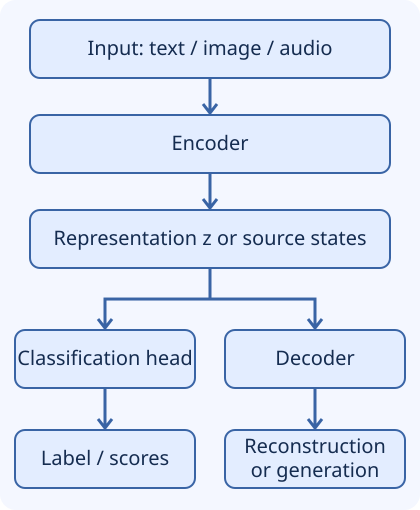

## Separate the jobs from the architecture family

An **encoder** transforms an input into a representation useful for another
computation. A **decoder** turns representations or context into an output. These
words describe roles; they do not uniquely identify an architecture. An encoder can
be a CNN, RNN, or Transformer. A decoder might reconstruct pixel values, synthesize
audio, or generate target tokens one by one.

You need matrix multiplication and the distinction between a loss and a prediction.
This lesson teaches you to trace representations, explain what a reconstruction
objective encourages, and identify the information a decoder can actually access.



Text alternative: input → encoder → representation. A classification head can map
that representation directly to a label; a decoder can map it to a reconstruction
or output sequence. Classification does not require a generative decoder.

| Application | Encoder produces | Output stage | Objective example |
| --- | --- | --- | --- |
| Image classification | Image features | Small classification head | Correct class |
| Translation | Source-sentence states | Decoder conditioned on source and target prefix | Correct next target token |
| Autoencoding | Latent representation | Reconstruction decoder | Similarity to original input |
| Retrieval | Whole-text vector | Similarity comparison or ranking | Bring relevant pairs closer |

The representation is an intermediate activation. The prediction is the output for
the task. The same vector might be a final product for an embedding API and an
intermediate value inside a classifier. Meaning depends on where you draw the system
boundary, not just on the array's shape.

## What representation learning learns

Hand-engineered features encode choices made by a developer. Representation learning
adjusts transformations to produce features useful under a training objective.
Training two models on the same documents with different objectives can produce
very different retrieval behavior. A vector is not inherently “semantic” merely
because it has many dimensions or came from a neural network.

An autoencoder commonly learns `z = encoder(x)` and `x_hat = decoder(z)` by minimizing
reconstruction loss. For continuous features a simple example is mean squared error:

```text
L = (1/D) * sum over j=1..D of (x_hat[j] - x[j])^2
```

Other data types and tasks need different losses. A latent bottleneck can encourage
useful information selection, but a network with sufficient capacity might learn an
identity-like mapping or memorize training examples. Regularization, denoising,
architectural constraints, and downstream evaluation all matter. A smaller latent
dimension is not by itself a guarantee of compression in bytes, interpretable
factors, or useful similarity geometry.

## Work through a numerical encoder and decoder

Use manually chosen matrices to make every shape and value visible:

```text
x = [2, 1, 0]            shape (3,)
E = [[1, 0,  1],        shape (2,3)
     [0, 1, -1]]
z = E @ x = [2,1]       shape (2,)

D = [[1,    0],         shape (3,2)
     [0,    1],
     [0.5, -0.5]]
x_hat = D @ z = [2,1,0.5]
```

The first encoded component is `2+0=2`; the second is `1-0=1`. The decoder's third
component is `0.5*2 - 0.5*1 = 0.5`. The error is `[0,0,0.5]`, and reconstruction
MSE is `(0 + 0 + 0.25)/3 = 1/12 ≈ 0.08333`.

This preserves the authored example and adds checks for shapes and values:

```python
import numpy as np

x = np.array([2.0, 1.0, 0.0])
encoder = np.array([[1.0, 0.0, 1.0], [0.0, 1.0, -1.0]])
decoder = np.array([[1.0, 0.0], [0.0, 1.0], [0.5, -0.5]])
z = encoder @ x
reconstruction = decoder @ z
mse = np.mean((reconstruction - x) ** 2)
assert z.shape == (2,) and reconstruction.shape == (3,)
np.testing.assert_allclose(z, [2., 1.])
np.testing.assert_allclose(reconstruction, [2., 1., 0.5])
assert np.isclose(mse, 1 / 12)
print("latent:", z)
print("reconstructed:", reconstruction)
print("MSE:", round(float(mse), 5))
```

Expected output is latent `[2. 1.]`, reconstruction `[2. 1. 0.5]`, and MSE `0.08333`.
There is **no training**: these matrices were selected manually. A trained
autoencoder would optimize parameters over many samples. A rank-at-most-2 linear
map cannot reconstruct every possible 3-dimensional vector exactly; it could still
reconstruct data restricted to a suitable lower-dimensional subspace.

For a batch of `B` row-vector examples with shape `(B,3)`, use `X @ encoder.T`
to produce `(B,2)`, then `Z @ decoder.T` to return `(B,3)`. The transpose reflects
the row-vector convention, not a different model.

## Why reconstruction does not guarantee retrieval quality

Suppose two product images show the same item against very different backgrounds.
A pixel reconstruction objective may reward preserving background texture, even
if item identity is what matters for retrieval. A contrastive or task-specific
objective may instead encourage invariance to the irrelevant background. Neither
objective wins universally: the representation must be evaluated for its intended
use, including domain and population shifts.

For anomaly detection, a high reconstruction error can be a useful signal only if
the model reconstructs normal cases well and fails in a distinguishable way on
anomalies. A flexible autoencoder may also reconstruct anomalies well, and a harmless
change in lighting can produce high error. Choose a threshold using representative
validation data and test the assumed relationship.

## From one vector to a sequence of source states

The 2014 sequence-to-sequence model of Sutskever, Vinyals, and Le encoded a source
sequence into a fixed-dimensional vector, then decoded a target sequence from it.
That is an important design, not the definition of every encoder–decoder.
Bahdanau, Cho, and Bengio instead let the decoder attend over source annotations,
reducing reliance on a single fixed-vector bottleneck.

For source length `S` and hidden width `H`, keep encoder states of shape `(S,H)`.
At target step `t`, the decoder can compute a context from those states and its
current query. A weighted sum with `S` attention weights returns a context of shape
`(H,)`. Padding positions need masking; not every array row represents a real token.

```text
source x1, x2, x3 --> encoder --> [s1, s2, s3]
                                    |  |  |
previous target prefix --> decoder <--- context from source states
                              |
                              v
                      next-target distribution
```

The conditional generation objective factors a target sequence as:

```text
P(y1,...,yT | source)
  = product over t=1..T of P(y_t | y1,...,y_(t-1), source)
```

At training time, **teacher forcing** provides the correct preceding target tokens.
At ordinary autoregressive inference, the decoder instead consumes previously
generated tokens until a stopping condition. An early error can affect later output.
A Transformer can process those known training prefixes across positions with a
causal mask; token-by-token inference still has a sequential dependency.

## Encoder-only, decoder-only, and encoder–decoder labels

In Transformer terminology, an encoder is commonly bidirectional over its input,
a decoder-only language model commonly uses causal self-attention, and an
encoder–decoder model combines source encoding with target decoding and
cross-attention. These arrangements are distinct from the general functional roles.
Encoders can support generation with appropriate objectives and decoding strategies;
decoder-only models can produce representations and classifications. Avoid the
slogans “encoder means understanding” and “decoder means nothing but generation.”

The [architecture comparison](architecture-selection.md) explains why one arrangement
might fit a task. Detailed attention implementation belongs to the later Transformers
topic; no unfinished Transformer lesson is needed as a prerequisite here.

## Recall and design exercise

1. Calculate `z`, reconstruction, and MSE for the matrices above without running code.
2. Describe a classifier without a generative decoder and a translator with one.
3. Why might reconstruction preserve features that make retrieval worse?
4. Draw a translator that can access all three source states at every target step.
5. How does teacher forcing differ from normal autoregressive inference?

Check against the worked results only after attempting them. A strong explanation
names shapes, information paths, objective, and downstream evaluation. Merely saying
“the encoder compresses and the decoder decompresses” misses conditional generation
and the full-state sequence design.

## Verified sources

- [Sutskever, Vinyals, and Le, Sequence to Sequence Learning with Neural Networks (2014)](https://arxiv.org/abs/1409.3215): fixed-vector LSTM encoder–decoder.
- [Bahdanau, Cho, and Bengio, Neural Machine Translation by Jointly Learning to Align and Translate](https://arxiv.org/abs/1409.0473): source annotations and attention rather than a single-vector bottleneck.
- [Vaswani et al., Attention Is All You Need, section 3](https://arxiv.org/html/1706.03762v7): sequence representations, decoder masking, and cross-attention.
