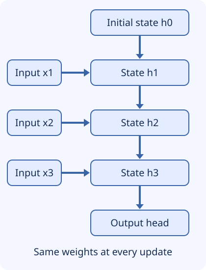

## Why carry state through a sequence?

Text, speech, and telemetry have order. A classifier seeing one temperature reading
cannot distinguish a stable level from a rapid rise unless history is represented
somewhere. A feed-forward network can accept a fixed window, and temporal CNNs can
also process sequences. An RNN offers another design: update a learned hidden state
for every observation, reusing the same parameters at each step.

You need weighted sums, matrix-vector multiplication, and the idea that training
uses derivatives. By the end, you should be able to trace the forward calculation,
explain why long-range learning is difficult, and justify a streaming-state design.



Text alternative: `(h0, x1) → h1`; `(h1, x2) → h2`; `(h2, x3) → h3 → output`.
Every state update uses the **same** learned weights. The diagram unrolls one
recurrent cell, not three independently parameterized layers.

## The recurrence and its shapes

For column vectors, a vanilla tanh RNN computes:

```text
h_t = tanh(W_x @ x_t + W_h @ h_(t-1) + b)
```

If an input has `D` features and the state has `H` features, `x_t` has shape `(D,)`,
`W_x` has shape `(H,D)`, `W_h` has shape `(H,H)`, and `b` and `h_t` have shape `(H,)`.
The head might compute a label from the final state, or produce a prediction at each
step. A stack of recurrent layers adds depth within each time step as well.

The state is an activation that changes for every input, **not a learned parameter**.
Inference updates the state while the recurrence weights normally stay fixed.
PyTorch exposes separate input and recurrent biases; their sum corresponds to the
single `b` here. Row-vector implementations transpose the matrices accordingly.

## Trace a tiny RNN

Use scalar inputs `[1,0,1]`, initial state 0, and fixed weights:
`h_t = tanh(x_t + 0.5*h_(t-1))`.

| Step | Input | Value before tanh | State, approximately |
| --- | --- | --- | --- |
| 1 | 1 | `1 + 0.5*0 = 1` | 0.7616 |
| 2 | 0 | `0 + 0.5*0.7616 = 0.3808` | 0.3634 |
| 3 | 1 | `1 + 0.5*0.3634 = 1.1817` | 0.8280 |

Keep full precision internally and round only for display. This preserves the
authored forward-pass example and checks that carrying state across two chunks is
equivalent to processing the same observations in one pass:

```python
import math

def advance(inputs, initial=0.0):
    h = initial
    states = []
    for x in inputs:
        h = math.tanh(x + 0.5 * h)
        states.append(h)
    return h, states

inputs = [1.0, 0.0, 1.0]
final, states = advance(inputs)
for step, h in enumerate(states, start=1):
    print(step, round(h, 4))
prefix, _ = advance(inputs[:2])
continued, _ = advance(inputs[2:], prefix)
assert math.isclose(final, continued)
assert len(states) == 3
```

Expected states round to `0.7616`, `0.3634`, and `0.8280`. There is no optimizer here:
the weights were chosen by hand. A trained RNN would learn its parameters across
examples to minimize a task loss.

## Why gradients vanish or explode

Training unrolls the recurrence and applies **backpropagation through time** (BPTT).
Each earlier state influences later states through repeated differentiable updates.
For the scalar recurrence above:

```text
dh_t / dh_(t-1) = 0.5 * (1 - h_t^2)
dh_T / dh_0 = product of those local derivatives over t=1..T
```

Since each factor here is at most 0.5 in magnitude, a path through 20 steps is at
most `0.5**20 ≈ 0.000000954` even before accounting for saturation. A late error
therefore gives an extremely weak learning signal to a distant early state. With a
different recurrent matrix, products can instead amplify and explode. In vector
networks the factors are Jacobian matrices, so this scalar bound is an illustration,
not a general formula for all RNNs.

Forward memory loss and vanishing gradients are related but different questions:
one concerns what the current state retains; the other concerns whether the training
signal can teach useful earlier computations. Gradient clipping limits large
gradients; it does not restore a vanished signal. Truncated BPTT reduces training
cost by cutting gradient paths at a chosen history length, not by making that history
dependency disappear from the problem.

## How gates change the state update

A common modern LSTM maintains both a hidden state `h_t` and a cell state `c_t`.
Sigmoid gates choose values between 0 and 1, with a separate learned affine
transformation of the current input and previous hidden state for each gate:

```text
f_t = sigmoid(W_f @ [x_t; h_(t-1)] + b_f)   # retain old cell content
i_t = sigmoid(W_i @ [x_t; h_(t-1)] + b_i)   # write new candidate
g_t = tanh(   W_g @ [x_t; h_(t-1)] + b_g)   # candidate content
o_t = sigmoid(W_o @ [x_t; h_(t-1)] + b_o)   # expose cell content
c_t = f_t ⊙ c_(t-1) + i_t ⊙ g_t
h_t = o_t ⊙ tanh(c_t)
```

`[x;h]` means concatenate, and `⊙` means multiply component by component. The
additive cell path can preserve information more easily than repeated vanilla tanh
updates. Along the direct cell path, retaining gates near 1 helps gradient flow;
the full derivative also includes dependencies through the gates and hidden states.
These are modern forget-gate equations, not a claim that every feature was in the
original 1997 LSTM.

**Worked gate calculation:** let old cell content be 2, forget gate 0.9, input gate
0.2, candidate 0.5, and output gate 0.8. Then new cell content is
`0.9*2 + 0.2*0.5 = 1.9`, and the hidden output is `0.8*tanh(1.9) ≈ 0.7650`.
The gates here are supplied values to isolate the mechanism; a real cell predicts
them from its learned parameters.

```python
import math

c_old, forget, write, candidate, expose = 2.0, 0.9, 0.2, 0.5, 0.8
c_new = forget * c_old + write * candidate
h_new = expose * math.tanh(c_new)
assert math.isclose(c_new, 1.9)
print(round(c_new, 4), round(h_new, 4))
```

A GRU uses a single hidden state, an update gate, and a reset gate rather than a
separate LSTM cell state. One common convention is
`h_t = (1-z_t) ⊙ candidate_t + z_t ⊙ h_(t-1)`; gate naming conventions differ, so
check the formula rather than assuming whether a large `z` means write or retain.
GRUs usually require fewer parameter groups than comparably sized standard LSTMs,
but speed and accuracy must be measured. Neither promises infinite memory or removes
the recurrence's sequential dependency.

## Streaming design and failure modes

A unidirectional RNN is naturally causal: the update uses only the prefix observed
so far. A bidirectional RNN also processes future observations backward and therefore
cannot be used unchanged for zero-lookahead live streaming. Causal temporal CNNs
and causal attention are other streaming options.

For an on-device sensor classifier, keep a separate state per stream, reset it at a
true sequence boundary, and define how dropped or reordered observations affect
time. Accidentally sharing state between users or devices mixes unrelated history.
Resetting after every chunk loses useful context; retaining forever can carry stale
context across sessions. Training should represent the chunking and resets used
at serving time.

An RNN's forward state storage can be fixed with respect to elapsed sequence length,
but BPTT training normally stores or recomputes intermediate activations. Do not
equate small inference state with constant-memory training.

## Recall and application

Without looking back, trace the recurrence for `[1,0,1]`, explain state versus
parameter, and describe why 20 multiplications by 0.5 weaken an error signal. Then
answer: would resetting hidden state every 50 milliseconds help a speech recognizer
that needs information from 30 seconds earlier?

Check your reasoning: resets remove that cross-chunk path. Keeping state preserves
the opportunity to use history, not a guarantee of retaining the specific detail.
Compare a GRU, an LSTM, and bounded-context attention on realistic long-delay
examples, with memory and latency measured per stream.

## Sources and continuation

- [PyTorch RNN reference](https://docs.pytorch.org/docs/stable/generated/torch.nn.RNN.html): recurrence, reused weights, biases, and shape conventions; resolved 2.14 documentation reviewed.
- [PyTorch LSTM reference](https://docs.pytorch.org/docs/stable/generated/torch.nn.LSTM.html): modern gate equations, hidden/cell states, and bidirectional behavior; resolved 2.14 documentation reviewed.
- [Vaswani et al., Attention Is All You Need, sections 1 and 4](https://arxiv.org/html/1706.03762v7): recurrent sequential dependencies, path lengths, and training parallelism.

The source module cites Hochreiter and Schmidhuber's 1997 LSTM paper; its hosted PDF
could not be retrieved during publication review. Gate-specific explanations above
are checked against the accessible primary implementation documentation instead.
Continue to [encoders, decoders, and representations](encoder-decoder.md).
