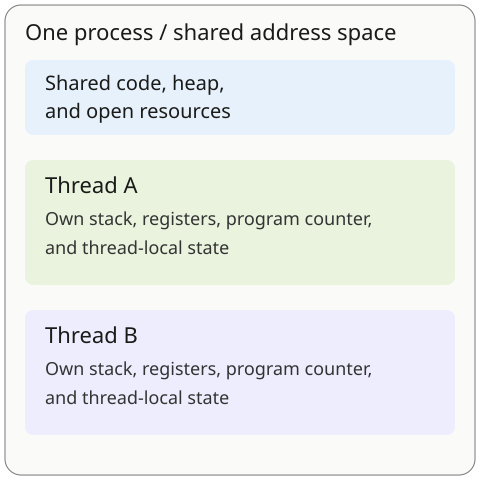

## Start here: the vocabulary you need

You need basic variables, functions, and loops. You do not need prior OS knowledge.
The code later uses Python 3, but the execution trace is language-independent.

| Term | Working meaning for this lesson |
| --- | --- |
| Program | Instructions stored in a file; it is not necessarily running. |
| Process | A running instance with an address space and OS-managed resources. |
| Virtual address space | The process's view of memory addresses. The OS and hardware map these to physical memory. |
| Heap | Memory used for dynamically allocated objects. |
| Stack | Memory holding function calls, local execution context, and return information. |
| Registers / program counter | CPU execution state, including where execution continues. |
| Scheduler | The OS mechanism that chooses which runnable execution thread gets a CPU. |

**Our central question:** when two tasks run, do they use separate environments or
share an environment? Understand that first. Scheduling states and child cleanup
are separate extensions near the end.

## Intuition: an environment and its execution paths

A process supplies an environment: memory mappings, open resources, and OS
bookkeeping. A thread is an execution path inside that environment. A process
normally starts with at least one thread and may create more.

Imagine a workshop with several workers. The workshop contains shared tools and
materials; each worker has a current task and their own position in its instructions.
Sharing makes coordination convenient, but workers can interfere with one another.

The analogy has limits: threads are not security boundaries. A native thread can
overwrite memory used by another thread in the same process.

Two threads do not necessarily execute at the same instant. **Concurrency** means
their work can overlap in progress; **parallelism** means execution at the same
instant on multiple cores. A single CPU can interleave runnable threads.

## What is shared, and what is private?



| Resource | Threads in one process | Separate processes |
| --- | --- | --- |
| Virtual address space | Shared | Normally isolated |
| Code and heap | Shared mappings | Separate mappings unless explicitly shared |
| Open resources | Many are shared; exact rules depend on the OS | Sharing can use inheritance or explicit IPC |
| Registers and program counter | Per thread | Per execution thread |
| Stack and thread-local storage | Per thread | Each process's threads have their own |

Thread-local storage is data associated with a particular thread rather than a
single shared variable. “Own stack” describes how execution is organized, not an
access-control barrier: a pointer to a live stack variable can be passed to another
native thread. Its lifetime and synchronization still matter.

Processes **can** communicate and share memory. They normally have separate address
spaces, so sharing requires a mechanism such as a shared-memory mapping, pipe, or
socket. Threads already share their process's address space.

## Predict a lost update

Suppose two workers each increment one shared counter, initially zero. An increment
in our model has three steps: read the counter, add one locally, write the new value.
**Predict the result before reading the trace.** Must it be two?

| Step | Worker A | Worker B | Shared counter |
| --- | --- | --- | --- |
| 1 | Reads 0 | | 0 |
| 2 | | Reads 0 | 0 |
| 3 | Computes 1 | | 0 |
| 4 | | Computes 1 | 0 |
| 5 | Writes 1 | | 1 |
| 6 | | Writes 1 | 1 |

The result is **one**: both computations used the same old value. This deterministic
trace demonstrates a possible lost update without relying on a flaky experiment.
It is a model of an unprotected read-modify-write sequence, not a claim that every
language implements `counter += 1` as those exact machine instructions.

Protect the whole read-modify-write sequence, not just its final write. A lock can
make that sequence a **critical section**, allowing one worker at a time. An
appropriate atomic operation can be another solution.

## Fix the update, then wait for completion

This Python 3 example uses a lock to coordinate shared access and `join()` to wait
for completion. You can run it locally; this website displays code without executing it.

```python
from threading import Lock, Thread

counter = 0
lock = Lock()

def add_one():
    global counter
    with lock:
        counter += 1

workers = [Thread(target=add_one) for _ in range(2)]
for worker in workers:
    worker.start()
for worker in workers:
    worker.join()

print(counter)  # 2
```

Both workers refer to the same counter and lock. `with lock` protects the update.
`start()` lets each worker run; `join()` waits until that worker terminates before
the main thread reads the final result.

**Check yourself:** would joining workers repair the lost-update trace if there
were no synchronization? No. It would wait for two completed but incorrectly
coordinated updates. Completion and mutual exclusion are different responsibilities.

Do not use this example to infer CPU speedups. Runtime behavior matters: ordinary
GIL-enabled CPython limits parallel execution of Python bytecode, while free-threaded
builds and other runtimes can differ. The shared-state model remains useful.

## Apply the model to a backend service

Consider a document-processing API with three requirements:

1. Handle requests that spend time waiting on storage or network I/O.
2. Maintain a small in-process metadata cache.
3. Process untrusted documents using a native library that might crash.

One reasonable design is a **bounded pool of request workers** sharing a process
and cache, with risky document conversion delegated to **separate worker processes**.
The request workers may be threads or async tasks depending on the runtime; they
are not automatically the same thing.

Why these boundaries?

- Shared memory makes the local cache easy to access, but updates need coordination.
- A process boundary can contain a converter crash that would otherwise take down
  threads in its own process. OS resource controls/sandboxing are additional concerns;
  merely launching a process is not a complete security sandbox.
- Separate workers need an explicit communication mechanism and have their own
  memory usage. They do not automatically share the request process's cache.
- Bound concurrency and apply backpressure so slow work does not create unlimited
  workers or exhaust memory and connections.

The lesson is not “threads are always faster” or “processes are always safer.”
Choose boundaries based on sharing, coordination, runtime behavior, and failure
requirements. Measure actual costs for the workload.

## Costs and runtime qualifications

Threads often require less setup than independent processes because they reuse an
address space and resources. Switching between threads in one process can avoid
some address-space switching work. Neither statement guarantees a fixed cost or
that a switch performs no TLB work: hardware, OS implementation, cache effects,
and scheduling all matter.

On Unix-like systems, `fork()` commonly uses copy-on-write. It creates a child
process without eagerly copying every physical memory page; there is still work
to create and manage the child.

Language-runtime tasks are not necessarily OS threads. Go schedules many goroutines
across OS threads. The OS schedules those threads; it does **not** see every Go
program as a single OS thread.

## Extension: scheduling states are a separate question

An execution path can exist without using a CPU at that moment. The familiar
five-state model is a teaching abstraction; real OSes expose more detailed states
and commonly schedule individual threads.

| State | Meaning | A typical next event |
| --- | --- | --- |
| New | Being created | Admitted to ready work |
| Ready | Runnable, waiting for CPU time | Scheduler dispatches it |
| Running | Executing on a CPU | Preemption, blocking, or exit |
| Blocked / waiting | Waiting for an event | Event completes; becomes ready |
| Terminated | Execution has ended | Resources/exit information are cleaned up |

After I/O completes, blocked work becomes **ready**, not necessarily immediately
running. If a time slice expires, runnable work can move from running to ready.

**Check yourself:** an idle CPU does not make a thread waiting for a disk result
runnable. The required event must occur first.

## Extension: zombie and orphan process cleanup

This Unix-like process lifecycle topic is separate from thread memory sharing.

- A **zombie** is a child that has exited but whose exit information has not yet
  been collected. It does not execute or retain its ordinary user address space,
  but it does retain kernel bookkeeping and a process-table/PID slot.
- An **orphan** is a child whose parent exited first. It may still be running.
  On Linux it is reparented to an eligible child subreaper or the relevant PID
  namespace's init process; this is not necessarily the host's PID 1/systemd.

Use a wait-family operation to reap child exit information. A zombie is already
dead, so sending it `kill -9` does not perform that cleanup. Fix the parent's
reaping behavior or arrange appropriate supervision; containers need a suitable
process to reap adopted children too.

## Revision: explain it without the page

- **Process:** environment and isolation boundary, with explicit sharing possible.
- **Thread:** execution path with its own execution state in that environment.
- **Shared updates:** coordinate the operation, not just the final result read.
- **Joining:** wait for completion; it does not replace synchronization.
- **Ready versus blocked:** able to run versus waiting for an event.
- **Zombie versus orphan:** exited child awaiting reaping versus child whose parent exited.

Now explain why the backend service used both shared request workers and separate
conversion workers. Then use Interview practice below: answer aloud before revealing
each answer, compare your reasoning with its criteria, and mark your own comfort
level only when you choose to.

## Sources and further reading

- [Linux pthreads overview](https://man7.org/linux/man-pages/man7/pthreads.7.html)
- [Linux fork documentation](https://man7.org/linux/man-pages/man2/fork.2.html)
- [Linux wait documentation](https://man7.org/linux/man-pages/man2/wait.2.html)
- [Linux PID namespace adoption](https://man7.org/linux/man-pages/man7/pid_namespaces.7.html)
- [Python threading documentation](https://docs.python.org/3/library/threading.html)
- [Go runtime scheduling terminology](https://go.dev/src/runtime/HACKING)
