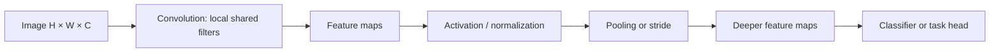
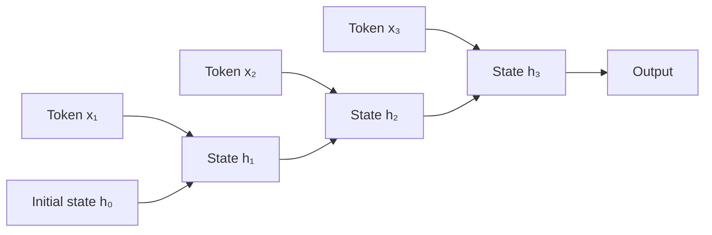
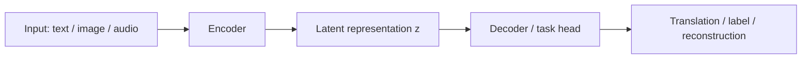

# AI Engineering — Deep Learning Architectures

> **Status:** authored learning module; review before publication. **Audience:** Python developers preparing for AI/backend engineering interviews. **Prerequisites:** tensors, matrix multiplication, neural-network training and backpropagation. Code examples are illustrative and can run with Python 3 and NumPy unless otherwise stated. This is educational prose, not yet adapted to any repository-specific YAML IDs.

## Learning goals

After completing this module, explain what architectural inductive bias means; trace a convolution and an RNN state update; distinguish encoders, decoders and encoder–decoder networks; identify the correct architecture for different data and compute constraints; and articulate why attention-based models displaced recurrence in many (not all) workloads.

---

# Lesson 1 — CNNs: locality, filters, and feature hierarchies

## The problem CNNs address

A fully connected network applied to a 224 × 224 RGB image receives 150,528 inputs. A dense first layer with 1,000 neurons would require about 150 million weights, before biases. Worse, it must independently learn that a small edge in the top-left and the same edge in the bottom-right have similar meaning. Convolutional networks impose a useful **inductive bias**: nearby pixels interact locally, and the same feature detector is applied across locations.

A CNN is not restricted to images: convolutions also appear in audio, temporal data and other grid-like signals. Its usefulness depends on whether local patterns and shared features match the problem.

## Mechanism

For an image with shape `(height, width, channels)`, a convolutional layer applies a collection of kernels. Each kernel computes weighted combinations over a local region and slides across the image. One kernel produces one output feature map (more precisely, each output channel has a filter spanning all input channels).



The cross-correlation operation used by most deep-learning libraries (usually called convolution) for one channel is:

\[Y_{i,j}=\sum_{u=0}^{k_h-1}\sum_{v=0}^{k_w-1}K_{u,v}X_{i+u,j+v}+b.\]

For a kernel of height `k_h`, width `k_w`, stride `s`, and padding `p`, the output height is `floor((H+2p-k_h)/s)+1`; width is analogous. Dilations alter the effective kernel size and therefore this formula.

**Parameter comparison:** A `3×3` convolution from 3 input channels to 16 output channels uses `3 × 3 × 3 × 16 = 432` weights, plus 16 biases. Compare that to a dense layer mapping 150,528 input values to 16 output values: over 2.4 million weights. They do *different computations*, so parameter count alone doesn't imply one always works better.

## Trace a convolution by hand

Consider a 3×3 input and 2×2 horizontal-change detector:

```text
input                kernel
1  1  4             -1  1
2  2  5             -1  1
3  3  6
```

At the top-left: `(-1×1)+(1×1)+(-1×2)+(1×2)=0`. At top-right: `(-1×1)+(1×4)+(-1×2)+(1×5)=6`. Sliding with stride 1 and no padding produces:

```text
0  6
0  6
```

The filter responds to a transition toward larger values on the right; it is not yet an object detector. Deeper networks combine many such primitive signals.

## Runnable NumPy example

```python
import numpy as np

image = np.array([[1., 1., 4.], [2., 2., 5.], [3., 3., 6.]])
kernel = np.array([[-1., 1.], [-1., 1.]])

out_h = image.shape[0] - kernel.shape[0] + 1
out_w = image.shape[1] - kernel.shape[1] + 1
output = np.empty((out_h, out_w))
for i in range(out_h):
    for j in range(out_w):
        patch = image[i:i+2, j:j+2]
        output[i, j] = np.sum(patch * kernel)
print(output)  # [[0. 6.], [0. 6.]]
```

This demonstrates one channel and one filter. Production convolution implementations vectorize and optimize these operations; this loop is for understanding, not performance.

## Receptive fields, stride and pooling

A receptive field is the region of input capable of influencing a particular feature. Stacking small convolutions increases the effective receptive field. Striding reduces spatial resolution; pooling summarizes local neighborhoods, often increasing tolerance to small positional changes while discarding some detail. Larger receptive fields do **not** automatically mean the network uses all distant information effectively.

## Where CNNs work, and where they struggle

CNNs are effective when spatial locality, feature reuse and approximate translation equivariance are helpful. They can be efficient for image classification and edge devices. Pure convolutions do not naturally handle arbitrarily distant dependencies in one operation, and pooling/striding can lose fine spatial localization; detection and segmentation architectures compensate using multi-scale features, skip connections or other mechanisms.

**Scenario:** For defect detection on high-resolution industrial images, a CNN may be an attractive baseline. If tiny defects matter, aggressive pooling can destroy crucial detail. Evaluate the task, latency, data volume and deployment hardware rather than assuming the newest architecture wins.

**Common misconceptions:** (1) A convolution is just a small dense layer: it also shares weights across positions. (2) Pooling is always mandatory: many modern architectures use strided convolution or other aggregation. (3) CNNs are only for images: they also work on sequence and signal data.

**Active recall:** Why does a convolution have fewer parameters than a dense transformation over an entire image? What property is lost when you flatten the image before learning local filters? Calculate the output of a 5×5 input with a 3×3 kernel, stride 2, padding 1.

**Interview-ready answer:** “CNNs exploit local structure by applying shared spatial filters that detect patterns at multiple positions. Stacked layers build increasingly complex features. Their strengths are parameter sharing and locality; the trade-offs include sensitivity to architectural choices about receptive field and spatial resolution.”

---

# Lesson 2 — RNNs, sequence state and the limits of recurrence

## Why a static network isn't enough

Text, speech and telemetry are sequences: order matters, and the meaning of a current element often depends on previous elements. A recurrent neural network (RNN) processes elements step by step, updating a hidden state that summarizes preceding information.



A vanilla RNN uses a recurrence like:

\[h_t=\tanh(W_xx_t + W_hh_{t-1}+b).\]

The same weight matrices are reused at each step. `h_t` is not perfect memory: it is a learned, fixed-dimensional representation of the sequence so far.

## Trace a tiny RNN

Let the state and inputs be scalars: `h_t = tanh(x_t + 0.5 h_(t-1))`, starting from `h_0=0`. For `x=[1,0,1]`, calculate each step. Each state combines the current input with what remains of the previous state.

```python
import math
inputs = [1.0, 0.0, 1.0]
h = 0.0
for step, x in enumerate(inputs, start=1):
    h = math.tanh(x + 0.5 * h)
    print(step, round(h, 4))
```

This is a fixed-weight forward pass, not training. A trained RNN learns the recurrence parameters from data.

## Why distant information disappears

Training uses backpropagation through time: the recurrent computation is unrolled as a deep graph. Gradients flowing backward across many steps repeatedly multiply Jacobian terms. When their magnitudes tend to be small, gradients vanish; when large, they can explode. The practical result is difficulty learning some long-distance dependencies.

Gated RNNs such as LSTMs and GRUs control updates and information retention using learned gates. They improve the situation but don't guarantee indefinite memory or remove sequential execution dependencies.

**Important distinction:** RNN recurrence imposes sequential state updates. During training, this makes it harder to parallelize across time steps than a standard full-sequence Transformer, even though operations *within* a step can be parallelized.

## Practical decisions

For an on-device streaming sensor classifier that updates one observation at a time and has tight memory constraints, an RNN/GRU may remain sensible. For training over long text sequences at scale, attention-based models often offer easier parallel training and more direct routes to distant context. Real-time transformers with caches introduce their own memory and compute costs.

**Common misconceptions:** “RNNs remember everything” (no: hidden state is a bottleneck); “LSTMs solve long-term dependencies completely” (they mitigate, not eliminate); “Transformers dominate every sequence problem” (deployment constraints and task structure matter).

**Active recall:** Explain why recurrence is naturally causal. What is the hidden state? Why can a product of many derivatives become very small? When might a GRU be preferable to a large Transformer?

**Interview-ready answer:** “RNNs process ordered inputs by updating a recurrent hidden state, making them naturally suited to sequential and streaming data. However, long-range dependencies can be difficult to train because of gradient behavior, and step-by-step recurrence limits training parallelism. Gated variants improve information retention.”

---

# Lesson 3 — Encoders, decoders and representation learning

## A separation of jobs

An **encoder** transforms an input into a representation useful for another task. A **decoder** turns a representation or prefix into an output. The words describe *roles*; they don't uniquely specify a neural architecture. Encoders might be CNNs, RNNs or Transformers. Decoders may generate output token by token or reconstruct a continuous signal.



Examples:
- **Classification:** an encoder creates features; a small head predicts a label. No generative decoder is required.
- **Machine translation:** an encoder represents a source sentence; a decoder generates the target sentence, typically using source representations while decoding.
- **Autoencoder:** an encoder compresses or transforms an input and a decoder attempts to reconstruct it. A bottleneck can encourage useful representations, but reconstruction quality does not guarantee suitability for every downstream task.

## Representation learning

Hand-engineered features encode assumptions chosen by a developer. Representation learning lets a model discover features that help optimize a training objective. What is learned depends on the objective and data. Two models trained on identical documents but with different objectives may learn representations with very different retrieval usefulness.

A latent vector can be smaller than the input, but *dimension alone* does not establish semantic quality or meaningful compression. Decoders might reconstruct inputs, generate new outputs or support conditional predictions.

## A simple numerical encoder–decoder (didactic)

```python
import numpy as np
x = np.array([2.0, 1.0, 0.0])
encoder = np.array([[1.0, 0.0, 1.0], [0.0, 1.0, -1.0]])
decoder = np.array([[1.0, 0.0], [0.0, 1.0], [0.5, -0.5]])
z = encoder @ x          # 2-dimensional representation
reconstruction = decoder @ z
print("latent:", z)
print("reconstructed:", reconstruction)
```

The matrices are chosen manually to illustrate shapes. They are *not trained*, so the reconstruction should not be judged as a learned autoencoder. A real autoencoder would optimize a reconstruction objective across samples.

## Encoder-only, decoder-only, encoder–decoder

These labels also appear in transformer models, but note the distinction between a general functional role and a particular transformer arrangement. A bidirectional encoder is useful for understanding/representation tasks; an autoregressive decoder produces output conditioned on prior tokens; an encoder–decoder architecture is especially natural for conditional generation such as translation. Actual implementations can break these conventions.

**Common misconceptions:** “Every encoder–decoder compresses to a single vector” (cross-attention can access a full sequence of encoder states); “Embedding means semantic understanding” (depends on training); “Encoder-only models cannot perform generation tasks at all” (task heads and decoding strategies complicate the slogan).

**Active recall:** What is the difference between a representation and a prediction? Why is reconstructing an input not necessarily enough to learn good classification features? Draw an encoder–decoder that translates a sentence while attending to all source positions.

**Interview-ready answer:** “An encoder maps inputs to learned features, while a decoder maps representations or context to outputs. The architecture and training objective determine whether the representation helps classification, retrieval, reconstruction or generation. Encoder–decoder is an arrangement of roles, not a single fixed network type.”

---

# Lesson 4 — Choosing architectures through engineering trade-offs

## Comparing the families

| Property | CNN | RNN / GRU / LSTM | Attention-based Transformer |
|---|---|---|---|
| Primary structural bias | Local spatial/temporal patterns, shared filters | Ordered sequence, recurrent state | Learned token-to-token interactions; position information supplied separately |
| Information over long distances | Grows through receptive fields/layers | Flows through recurrent state | Direct token interactions within attention pattern |
| Sequence training parallelism | Often strong for convolutions | Limited across recurrent steps | Strong for full-sequence teacher-forced training |
| Streaming inference | Depends on architecture | Natural via hidden state | Feasible with causal attention and KV cache; cache grows with context in standard attention |
| Characteristic constraint | Spatial detail and receptive field | State bottleneck / long-range gradients | Attention compute and memory for long sequences |

These are broad tendencies, not guarantees: convolutional sequence models, efficient attention variants and hybrid networks blur boundaries.

## Worked case: build a customer-support system

You need (a) image-based product damage detection, (b) streaming IoT anomaly alerts, and (c) natural-language ticket categorization. Rather than using one model everywhere:

1. Start image detection with a pretrained vision encoder/CNN baseline; measure accuracy on small defects and mobile inference latency.
2. For continuous device telemetry, compare feature-based statistical models, 1D CNNs and GRUs; quantify data requirements and streaming-state costs.
3. For tickets, establish a TF-IDF/logistic regression baseline before evaluating pretrained text encoders or LLM classification. Account for multilingual data and class imbalance.

This is deliberately a *model selection process*, not a claim that a particular architecture wins without evaluation.

## Decision checklist

Define objective and metrics first; identify data modality, dataset size and labels; check sequence length and dependence structure; choose baseline; characterize inference hardware/latency, memory and throughput; assess interpretability/security needs; test in-distribution and out-of-distribution behavior; inspect error patterns before increasing model complexity.

## Interview exercise

**Question:** A streaming speech service has a strict 50-ms per-chunk budget and occasionally must reference information from 30 seconds earlier. Would you always choose a Transformer?

**Strong answer covers:** task-specific model selection; causal streaming constraints; RNN state versus attention cache; chunking and latency; long-context failure modes; device memory; evaluation on realistic speech segments; and why architecture alone doesn't determine performance.

## Quick review

CNN: local filters + weight sharing. RNN: state update + sequential dependence. Encoder: representation. Decoder: output generation/reconstruction. Transformer: attention plus other architectural components; explore in the next dedicated topic.

---

# Practice questions and rubric

1. **What does weight sharing mean in convolution?** Explain its parameter and inductive-bias effects, not just that it “saves memory.”
2. **Show the computation of a tiny convolution.** Accurately multiply and sum all filter coefficients; handle padding/stride.
3. **What makes an RNN recurrent?** State update and reused weights; distinguish recurrence from a generic stack of layers.
4. **What causes vanishing gradients in long sequences?** Backpropagation through time and repeated derivative products; qualify that behavior depends on parameters and activations.
5. **Why do LSTMs have gates?** Selective information retention/updates, not infinite memory.
6. **What distinguishes an encoder from a decoder?** Roles and objectives, with two different examples.
7. **Does reconstruction guarantee useful embeddings?** No; training objective and evaluation task matter.
8. **CNN vs GRU vs Transformer for real-time telemetry?** Compare task, sequence length, deployment constraints and baselines before naming a winner.
9. **Why did attention-based models become popular for long-range sequence tasks?** More direct interactions and training parallelism, alongside computational limitations.
10. **Can an architecture family be chosen without experiments?** Only as a candidate; define metrics and benchmark realistically.

**Self-marking guidance:** For each question, answer without looking, then verify (a) correctness, (b) mechanism, (c) caveats, and (d) one practical implication. Mark incomplete explanations for revision; do not classify a topic as mastered just because the terms feel familiar.

# Sources and further reading

- Stanford CS231n convolutional networks notes: https://cs231n.github.io/convolutional-networks/
- PyTorch Conv2d documentation: https://docs.pytorch.org/docs/stable/generated/torch.nn.Conv2d.html
- PyTorch RNN documentation: https://docs.pytorch.org/docs/stable/generated/torch.nn.RNN.html
- Hochreiter & Schmidhuber, *Long Short-Term Memory* (1997): https://www.bioinf.jku.at/publications/older/2604.pdf
- Sutskever, Vinyals & Le, *Sequence to Sequence Learning with Neural Networks* (2014): https://arxiv.org/abs/1409.3215
- Vaswani et al., *Attention Is All You Need* (2017): https://arxiv.org/abs/1706.03762

References are reading/verification targets. Verify any version-dependent API behavior against the current upstream documentation before publication.
